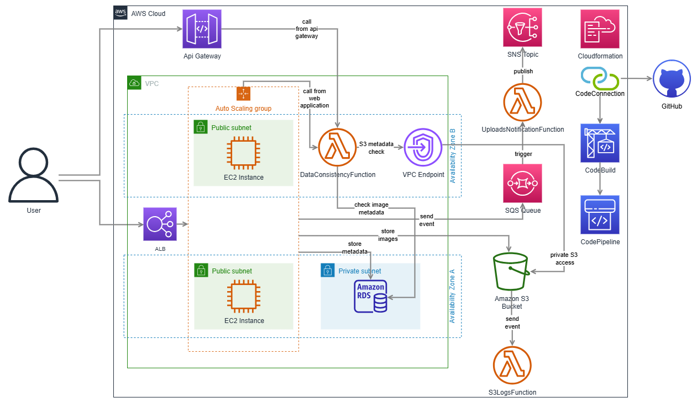

## What’s given
- your AWS account. 
- the S3 image bucket from [Module 4: S3](../ci_cd/README.md).
- the SNS/SQS resources from [Module 9: SNS/SQS](../sns_sqs/README.md).
- the image management application from [Module 10: Serverless](../serverless/README.md).

## Demo tips
It might take some time to make a commit and wait for the CodePipeline to fully complete. So, to
reduce the demo duration, it’s recommended to:
  - make a commit and deploy the Lambda before the demo
  - demonstrate that the commit and the active Lambda deployment are mentioned in the
most recent CodePipeline execution

## What to save money on
In case you’re not planning to experiment with your AWS resources after the demo, remove your S3
bucket, VPC, SNS topic, SQS queue, RDS instance, Lambda function(s), CodeBuild
resources, CodeDeploy resources, CodePipeline pipeline.

## What to do

### Sub-task 1 – Create and deploy SAM application

1. Create a SAM application for the _\<ProjectName\>-UploadsNotificationFunction_ from the [Module 10: Serverless](../serverless/README.md):
   - Create a SAM template for the lambda function and store it in the root of your project
   - Specify IAM roles, required for integration with SNS, SQS from [Module 9: SNS/SQS](../sns_sqs/README.md)
   - Specify IAM role to allow storing logs in CloudWatch
   - Following this [tutorial](https://docs.aws.amazon.com/serverless-application-model/latest/developerguide/automating-updates-to-serverless-apps.html), define any *DeploymentPreferenceType* you wish
   - *Optionally*: specify in the template additional Lambda functions for testing the SAM (you can choose _\<ProjectName\>-S3LogsFunction_ from the [Module 10: Serverless](../serverless/README.md))
   deployment
2. Delete the _\<ProjectName\>-UploadsNotificationFunction_ from [Module 10: Serverless](../serverless/README.md).
3. Following this [tutorial](https://docs.aws.amazon.com/serverless-application-model/latest/developerguide/serverless-sam-cli-install.html), install SAM CLI on your local machine.
4. Using the terminal on your local machine, execute **sam deploy** CLI command with appropriate
   flags to store the packaged lambda to S3 and deploy it with the appropriate resources. Under the packaged lambda is considered some
   executable artifact(for example jar file for Java).
5. In AWS console, open Lambda service and find in **Functions** section your deployed lambda
   function. Also, in **Applications** tab, find your deployed SAM application and review all created
   resources.
6. Upload a new image to the image S3 bucket using your web-application and ensure an email notification which mentions the image is sent.

### Sub-task 2 – Build CI/CD pipeline

1. We need to create a CodeConnection that will be used in the configuration of CodeBuild and CodePipeline.
   At this stage, we need to select a provider, such as GitHub using [this tutorial](https://docs.aws.amazon.com/dtconsole/latest/userguide/connections-create-github.html) or GitLab using [this tutorial](https://docs.aws.amazon.com/dtconsole/latest/userguide/connections-create-gitlab.html).
   The following instructions are tailored for the GitHub provider.
2. Following [this tutorial](https://docs.aws.amazon.com/codebuild/latest/userguide/build-spec-ref.html) create a CodeBuild spec, which would:
   - provide instructions for testing the code (optionally)
   - build the executable artifact(for example jar file for Java)
   - package the code for the Lambda function using **sam package** CLI command.
   - specify the generated output template file as build artifact in the artifacts section for
   further using it for deploy.
   - Add this сreated CodeBuild spec in your repository
   - **Important**: don’t use **sam deploy** cli command here. The _\<ProjectName\>-UploadsNotificationFunction_ Lambda will be deployed through
   CodeDeploy service.
3. Create a CodeBuild project using AWS console:
   - Choose your source provider (GitHub or GitLab). 
      Navigate to the 'Credential' section and click on 'Manage account credentials.' 
      In the 'Manage default source credential' window that appears, select 'Credential Type' as either 'GitHub App' or 'GitLab.' 
      Then, choose the CodeConnection you created in the \#1 step.
   - Choose your own repository, which already contains the CodeBuild spec, as the source provider.
      Ensure that you have previously created this CodeBuild spec and added it to your repository in a prior step.
   - configure environment for building the artifact
   - specify S3 bucket for storing the build artifact
   - Manually start the build. Verify that output template file, generated by sam package
   command, was stored in S3. In the CodeUri section of this file, you could find the link to the
   packaged Lambda code, stored in S3.
   
   **Note.** If you see the error 'Webhook creation failed' while creating a CodeBuild project, 
   click 'Edit' for that CodeBuild project, check the 'Rebuild every time a code change is pushed to this repository' option in the 'webhook' section again, and save. 
   This should resolve the issue.
4. Create a CodePipeline project and configure:
   - In 'Creation options' select 'Build custom pipeline'.
   - **Source Stage** - **GitHub/GitLab** - automatically runs after commit into your repo from and pulls all your sources
   - **Build Stage** - **Code Build** - uses your source code and runs SAM package to upload lambda
   source/package to S3 and generates CloudFormation **output template**. You could reuse
   already create build project from the previous step
   - **Deploy Stage** - **Cloud Formation** as action provider - uses **output template** from second
   step to deploy lambda
5. Delete the _\<ProjectName\>-UploadsNotificationFunction_ Lambda function.
6. Make some changes to the Lambda function code and ensure the CodePipeline builds and deploys
   it.
7. Upload a new image to the image S3 bucket using your web-application and ensure an email notification which mentions the image is sent.

## What should I remember?
> - Once you create AWS Account -> Setup Multi-factor Authentication
> - Do NOT share your account
> - Do NOT commit your account Credentials into the Git
> - Terminate/Remove all created resources/services once you finish Module
> - Please Do not forget to delete NAT Gateway if you used it.
> - Do NOT keep instance running if you don’t use it
> - Carefully keep track of billing and working instances so you don't exceed limits 
