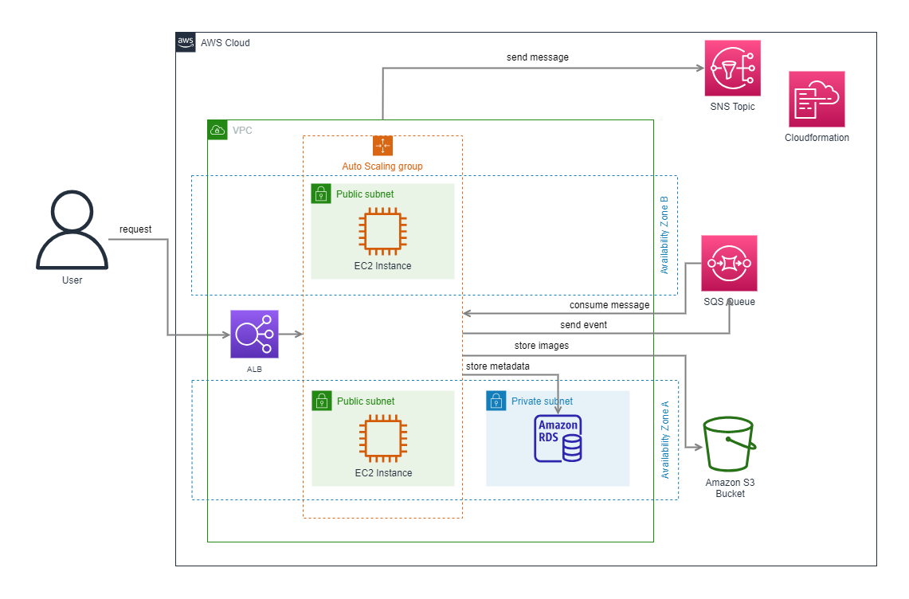
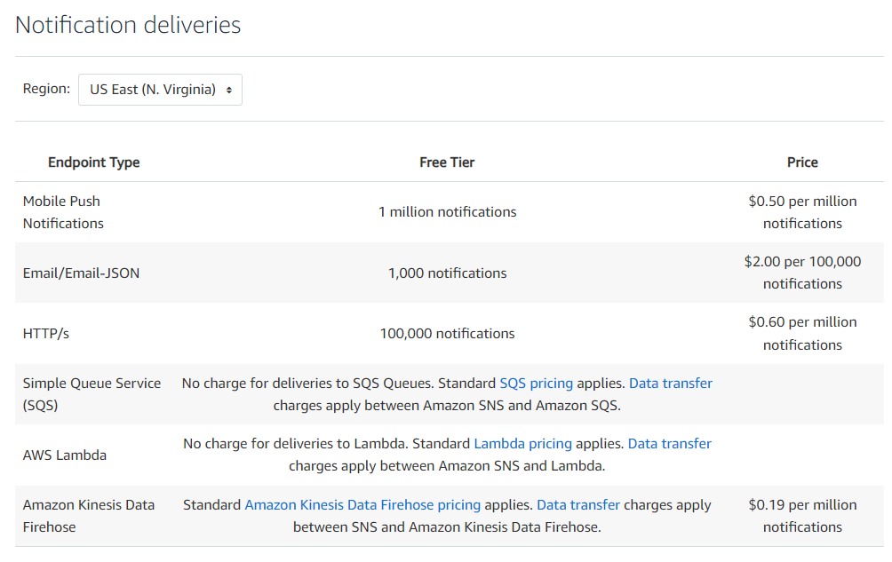

## What’s given
- Your AWS account. 
- The web application from [Module 7: RDS](../rds/README.md).

## What to save money on

- Prefer removing the resources created using the CF template(s) while not working on any practical tasks (the CF template should allow you to quickly re-create them in one shot as needed).
- Consider [stopping](https://docs.aws.amazon.com/AmazonRDS/latest/UserGuide/USER_StopInstance.html) your RDS instance while not working on any practical tasks.
  
## What to do

### Keep them in mind SNS limits

### Sub-task 1 – Implement a subscription feature in your web application

1. Create a standard SQS queue named _\<ProjectName\>-UploadsNotificationQueue_.
2. Create an SNS topic named _\<ProjectName\>-UploadsNotificationTopic_.
3. Add two new endpoints in your web-applications :
   - subscribe an email for notifications
   - unsubscribe an email from notifications
4. After a user visits the subscription endpoint, the specified email should receive a confirmation message.
5. Whenever a user visits the unsubscription endpoint, AWS should stop sending notifications to the specified email.
6. Whenever an image is uploaded **using your web application**, a new message describing the event should be published to the SQS queue.
7. Update your web-application to run a scheduled background process which extracts the SQS messages in batch and sends them to the SNS topic.
8. The SNS notifications should be in plain text which includes:
   - an explanation that an image has been uploaded
   - the image metadata (size, name, extension)
   - a link to the web application endpoint for downloading the image
9. Optional: Add an attribute to the message your app will send to the SNS topic (such as an image extension) and configure the filtering policy for subscriptions to accept messages with a specific attribute value (such as .png).
11. Think what are the other ways of receiving SNS notifications for the image uploads (not necessarily in a human-readable form).

* *Optional Task is not mandatory for completion this module but highly recommended, if you don’t have a time to complete it - just skip it*

## What should I remember?

> - Once you create AWS Account -> Setup Multi-factor Authentication
> - Do NOT share your account
> - Do NOT commit your account Credentials into the Git
> - Terminate/Remove all created resources/services once you finishe Module
> - Please Do not forget to delete NAT Gateway if you used it.
> - Do NOT keep instance running if you don’t use it
> - Carefully keep track of billing and working instances so you don't exceed limits
