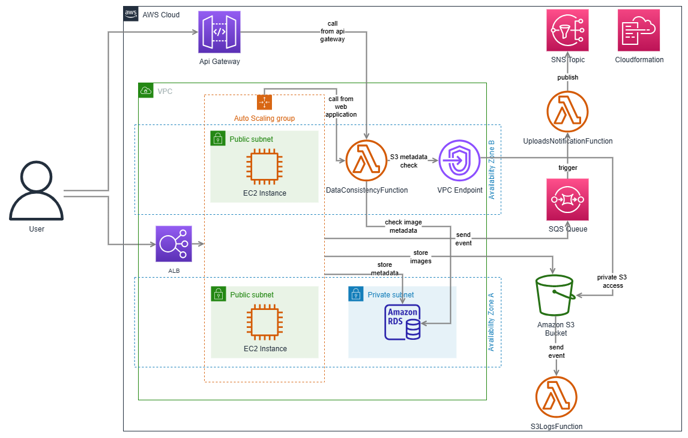

## What’s given
- your AWS account. 
- the S3 image bucket from [Module 3: S3](../ci_cd/README.md).
- the RDS instance from [Module 7: RDS](../rds/README.md).
- the web application, SNS/SQS resources from [Module 8: SNS/SQS](../sns_sqs/README.md).

## What to save money on

- Prefer removing the resources created using the CF template(s) while not working on any practical tasks (the CF template should allow you to quickly re-create them in one shot as needed). 
- Consider [stopping](https://docs.aws.amazon.com/AmazonRDS/latest/UserGuide/USER_StopInstance.html) your RDS instance while not working on any practical tasks.
- After the demo, consider removing the scheduled CloudWatch event which was created to trigger the lambda function on schedule.
- Also, after the demo, consider removing the _\<ProjectName\>-S3LogsFunction_ lambda function.

## What to do

### Sub-task 1 - Create a Lambda with Asynchronous Invocation (Polling Invocation)

1. Create a Lambda function named _\<ProjectName\>-UploadsNotificationFunction_:
   - use any preferred programming language
   - grant the function the basic Lambda permissions as well as permissions for sending messages to _\<ProjectName\>-UploadsNotificationTopic_ from the [Module 9: SNS/SQS](../sns_sqs/README.md)
2. Remove the code from the web-application that transfers SQS messages to SNS topic.
3. Add a Lambda trigger:
   - make sure that execution role of the Lambda contains permissions for the _\<ProjectName\>-UploadsNotificationQueue_ from [Module 9: SNS/SQS](../sns_sqs/README.md)
   - choose _\<ProjectName\>-UploadsNotificationQueue_ as SQS source
   - update the lambda code and implement sending messages to the _\<ProjectName\>-UploadsNotificationTopic_ topic (this logic was removed from your web-application)
4. Make 2 or more image uploads using your web application. Ensure you got exactly emails with all the publications you’ve just made.

### Sub-task 2 - Create a Lambda with Synchronous Invocation

1. Create a Lambda function named _\<ProjectName\>-DataConsistencyFunction_:
   - use any preferred programming language
   - grant the function the basic Lambda permissions as well as permissions to have access to the DB from [Module 8: RDS](../rds/README.md) and to the S3 bucket from [Module 4: S3](../s3/README.md)
2. **Important**: To ensure secure and private communication:
   - Create a VPC Endpoint for S3 to allow Lambda to access the S3 bucket without traversing the public internet.
   - Ensure the Lambda function resides in the same VPC as the RDS instance so it can securely access the DB.
3. Implement some basic validation that verifies that DB metadata corresponds to the images in the S3 bucket (you can add some simple validation like finding image by name). The lambda should return a result that shows if data is consistent or not.
4. **Important** Please keep in mind best practices of writing lambda code. Initializing connection to the DB should be outside the function.
5. Create an endpoint in your web application which would do the same – simply trigger the _\<ProjectName\>-DataConsistencyFunction_ Lambda.
6. Follow [this tutorial](https://docs.aws.amazon.com/AmazonCloudWatch/latest/events/RunLambdaSchedule.html) to make your Lambda run periodically (let’s say, every 5 minutes).
7. Make your Lambda logs scheduled/API Gateway/web application calls in such a way that it’s possible to distinguish them in the CloudWatch logs. **Hint** – the tutorial from step 6 makes the Lambda receive messages which have a _detail-type_ field, so it’s possible to fill that field differently for the calls made from the web application and API Gateway endpoint.
8. Make sure you can see all 3 (scheduled/API Gateway/web application) kinds of Lambda calls in the CloudWatch logs.

### Sub-task 3 - Create a Lambda with Asynchronous Invocation (Optional)

1. Create a Lambda function named _\<ProjectName\>-S3LogsFunction_:
   - use any preferred programming language
   - grant the function the basic Lambda permissions
2. Update an execution role of the lambda to contain the permissions for the S3 bucket from [Module 4: S3](../s3/README.md).
3. Configure your S3 image bucket to send object creation events to that Lambda.
   - Tip: Since the Lambda handler code is extremely simple, you may code it directly in the AWS Console using any of the available scripting language options.
5. Upload an image to your S3 bucket and ensure you can see the Lambda reacts to this in CloudWatch logs.

## What should I remember?

> - Once you create AWS Account -> Setup Multi-factor Authentication
> - Do NOT share your account
> - Do NOT commit your account Credentials into the Git
> - Terminate/Remove all created resources/services once you finishe Module
> - Please Do not forget to delete NAT Gateway if you used it.
> - Do NOT keep instance running if you don’t use it
> - Carefully keep track of billing and working instances so you don't exceed limits
